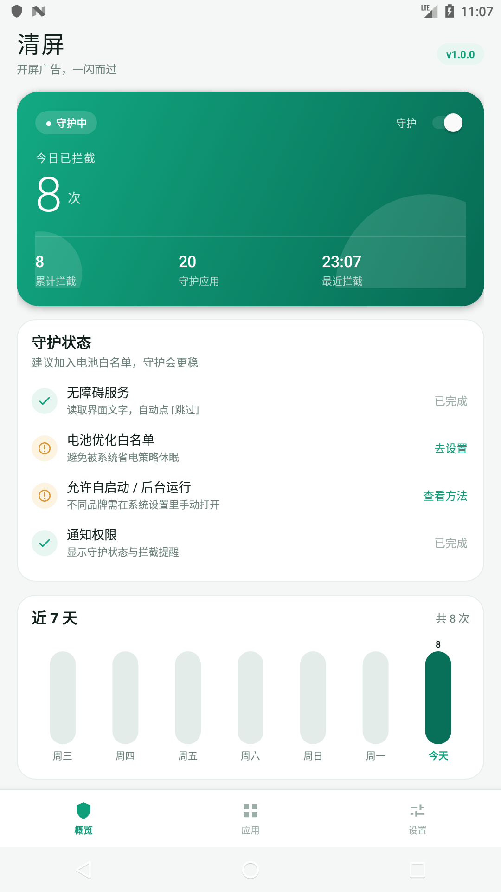
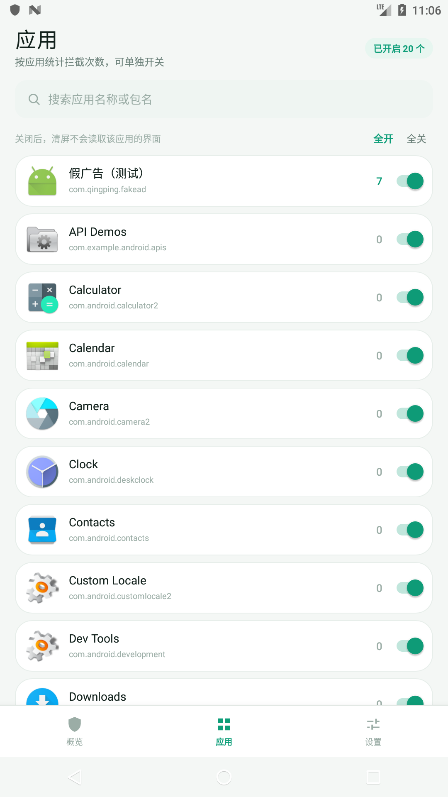
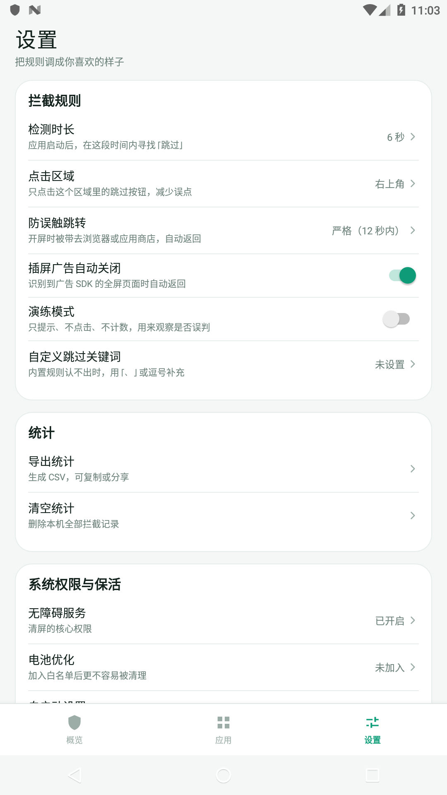
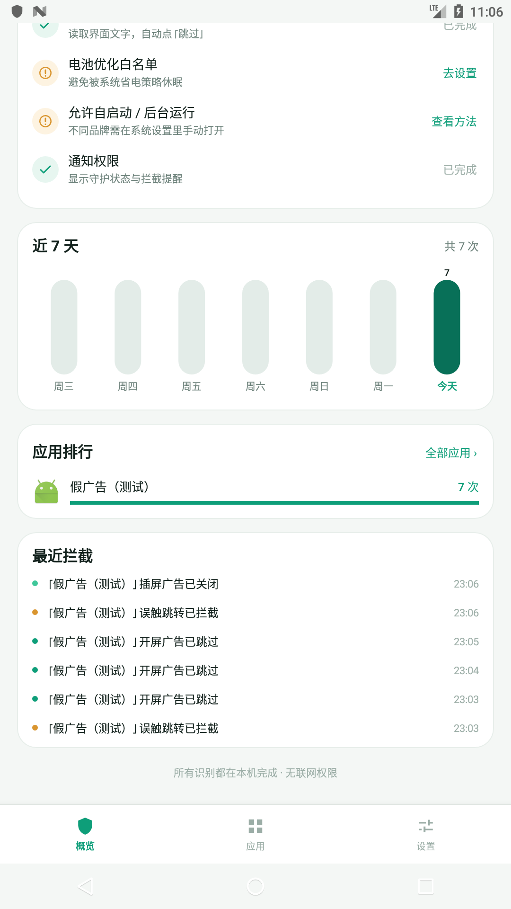
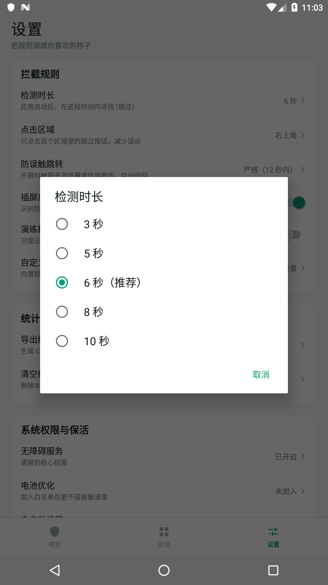
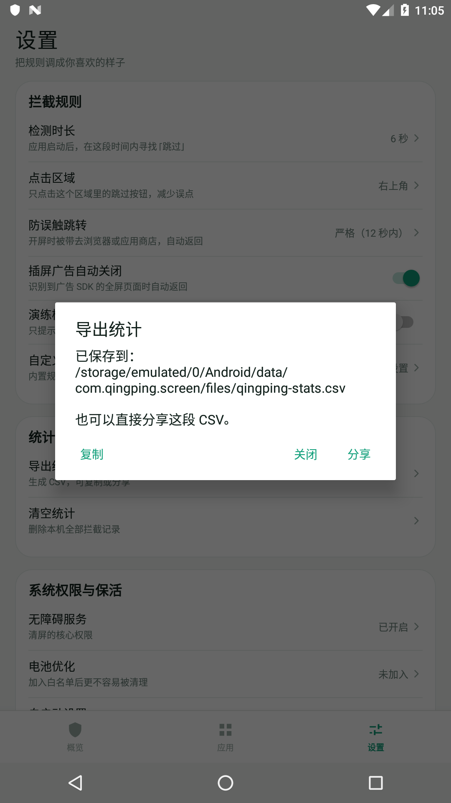

# 清屏（QingPing）

一个只在本机运行的 Android 开屏广告跳过工具：用无障碍服务识别并点击其他应用开屏广告上的「跳过」，拦住开屏阶段的误触跳转，并按应用统计拦截次数。

- 不联网：安装包内没有 `INTERNET` 权限
- 不 root、不 Xposed、不修改其他应用
- 所有统计只保存在本机 SQLite 数据库
- 支持 Android 7.0（API 24）到 Android 14（targetSdk 34）

## 界面预览

| 概览 | 应用与统计 | 设置 |
| --- | --- | --- |
|  |  |  |

| 应用排行 / 最近拦截 | 规则弹窗 | 导出统计 |
| --- | --- | --- |
|  |  |  |

---

## 一、它能做什么

| 能力 | 实现方式 |
| --- | --- |
| 自动点「跳过」 | 应用进入前台后的时间窗内，在指定屏幕区域查找「跳过 / 跳过广告 / 关闭广告 / skip」等文字、contentDescription 或广告 SDK 的控件 id，执行点击或坐标手势 |
| 误触跳转拦截 | 开屏阶段前台从 A 应用切到浏览器/应用商店时，自动按返回键回到 A，并记一次「误触跳转」 |
| 插屏广告自动关闭 | 当前 Activity 属于已知广告 SDK 时，自动按返回 |
| 按应用统计 | 每次成功拦截写入 `stats(pkg, day, cnt)`，应用列表、排行榜、近 7 天柱状图、最近记录都可查看 |
| 开机与保活 | 系统托管无障碍服务 + 前台通知服务 + 15 分钟 JobScheduler 巡检 + 厂商自启动设置引导 |
| 可调规则 | 检测时长、点击区域、自定义关键词、演练模式、防跳转严格/宽松、插屏开关、震动/提示开关 |

## 二、它做不到什么

- **纯图片按钮**：广告的「跳过」如果是没有文字、没有 contentDescription 的图片，无障碍读不到，无法点击。
- **Canvas / SurfaceView / 部分 WebView 广告**：没有可读的控件树，同样无法识别。
- **「摇一摇」传感器广告**：需要监听加速度计并拦截，普通应用做不到。
- **跳转发生前的拦截**：只能等前台真的切到浏览器/商店后再按返回，所以会看到一次闪烁。
- **厂商强行杀进程**：需要用户手动加白名单；被系统「强行停止」后，任何应用都无法自启。
- **不保证 100% 命中**：不同 App 的广告 SDK、布局、混淆方式都不同，规则只能覆盖常见文案与控件 id。

## 三、目录结构

```
qingping/
├─ app/src/main/
│  ├─ AndroidManifest.xml
│  ├─ java/com/qingping/screen/
│  │  ├─ QingPingApp.java                  Application 入口
│  │  ├─ core/
│  │  │  ├─ Prefs.java                     本地配置
│  │  │  ├─ StatsDb.java                   统计数据库（按应用 + 日期）
│  │  │  ├─ AppInventory.java              已安装应用清单与图标
│  │  │  ├─ SkipRules.java                 纯 Java 识别规则（可单测）
│  │  │  └─ JumpPolicy.java                误触跳转判定（可单测）
│  │  ├─ service/
│  │  │  ├─ GuardAccessibilityService.java 核心：扫描、点击、拦截、计数
│  │  │  ├─ GuardForegroundService.java    常驻通知与保活
│  │  │  ├─ BootReceiver.java              开机 / 更新后拉起
│  │  │  └─ KeepAliveJobService.java       15 分钟巡检
│  │  └─ ui/
│  │     ├─ MainActivity.java              概览 / 应用 / 设置三页
│  │     ├─ AppAdapter.java                应用列表
│  │     └─ BarChartView.java              7 日柱状图
│  └─ res/                                 布局、图标、无障碍配置
├─ tools/
│  ├─ build-apk.ps1                        不依赖 Gradle 的命令行构建
│  ├─ build-testapps.ps1                   构建两个验证用测试 APK
│  └─ RuleTest.java                        43 项规则断言
├─ testapps/
│  ├─ fakead/                              假开屏广告 / 假误触跳转 / 假插屏广告
│  └─ fakebrowser/                         假浏览器落地页
├─ keystore/                               本地签名目录（已 gitignore，不随仓库上传）
├─ dist/QingPing-1.0.0.apk                 已签名安装包
└─ docs/                                   图标与界面截图
```

## 四、构建

### 方式 A：Android Studio

直接用 Android Studio 打开本目录，等待 Gradle 同步完成，运行 `app` 即可。

- AGP 8.9.1
- compileSdk 35 / targetSdk 34 / minSdk 24
- 无 AndroidX、无第三方依赖

### 方式 B：命令行（不需要 Gradle）

需要：

- JDK 17 及以上
- Android SDK：`platforms;android-35`、`build-tools;35.0.0`

```powershell
powershell -ExecutionPolicy Bypass -File tools/build-apk.ps1 `
  -Sdk "C:\Android\Sdk" `
  -Jdk "C:\Program Files\Java\jdk-17"
```

脚本依次执行 `aapt2 compile → aapt2 link → javac → d8 → jar 合并 dex → zipalign → apksigner`，产物在 `dist/QingPing-1.0.0.apk`。

> 仓库不包含签名密钥：`tools/build-apk.ps1` 首次运行会自动生成 `keystore/qingping.jks`（口令 `qingping2024`）。`dist/` 里的 APK 是交付时签名的版本；自行重新构建会得到不同签名，覆盖安装前需要先卸载旧版。要正式分发请换成你自己的密钥并妥善保管。

## 五、安装与首次配置

```bash
adb install -r dist/QingPing-1.0.0.apk
```

打开「清屏」，按概览页的「守护状态」逐项完成：

1. **无障碍服务**（必需）
   设置 → 无障碍 → 已下载的服务 → 清屏 · 开屏广告跳过 → 打开。
   Android 13 及以上若开关是灰色：设置 → 应用 → 清屏 → 右上角 ⋮ → 允许受限制的设置。
2. **电池优化白名单**（强烈建议）
   点击「去设置」允许后台运行。
3. **自启动 / 后台运行**（按机型）
   小米：安全中心 → 应用管理 → 权限 → 自启动；
   华为：手机管家 → 应用启动管理 → 手动管理；
   OPPO/一加：设置 → 电池 → 应用耗电管理 → 允许后台运行；
   vivo：i管家 → 应用管理 → 权限管理 → 自启动；
   三星：设置 → 电池 → 后台使用限制 → 移出休眠应用。
4. **通知权限**（建议）
   用于显示「清屏正在守护 / 今日已拦截 N 次」。

## 六、权限说明

| 权限 / 能力 | 用途 | 是否必须 | 授予方式 |
| --- | --- | --- | --- |
| `BIND_ACCESSIBILITY_SERVICE`（无障碍服务） | 读取界面文字/控件 id、执行点击、按返回键 | 必须 | 用户在系统设置手动开启，应用无法代开 |
| `RECEIVE_BOOT_COMPLETED` | 开机后拉起前台通知服务 | 建议 | 安装即授予 |
| `FOREGROUND_SERVICE` / `FOREGROUND_SERVICE_SPECIAL_USE` | 常驻通知，降低被清理概率 | 建议 | 安装即授予 |
| `POST_NOTIFICATIONS` | 显示守护状态通知 | 建议 | Android 13+ 运行时申请 |
| `REQUEST_IGNORE_BATTERY_OPTIMIZATIONS` | 请求加入电池白名单 | 建议 | 系统弹窗确认 |
| `QUERY_ALL_PACKAGES` | 读取已安装应用列表、图标、名称 | 建议 | 安装即授予（应用商店分发会审核此权限） |
| `VIBRATE` | 拦截时轻震 | 可选 | 安装即授予 |
| `WAKE_LOCK` | 预留 | 可选 | 安装即授予 |

**没有申请**：`INTERNET`、`READ_SMS`、`READ_CONTACTS`、`SYSTEM_ALERT_WINDOW`、`PACKAGE_USAGE_STATS`。

## 七、统计口径

- 成功点击一次「跳过」= 1 次开屏拦截，记在**被打开的应用**名下。
- 自动按返回成功 = 1 次误触跳转，记在**跳转来源应用**名下。
- 插屏自动关闭 = 1 次插屏拦截，记在**当前应用**名下。
- 演练模式只弹提示，不写数据库。
- 「今日」按设备本地时区的自然日计算；数据库保留最近约 1500 条事件明细，聚合统计长期保留。

## 八、隐私

- 应用没有 `INTERNET` 权限，无法上传任何数据。
- 配置在 `SharedPreferences`，统计在 `qingping.db`，均位于应用私有目录。
- `backup_rules.xml` / `data_extraction_rules.xml` 已排除数据库与配置，不参与云备份。
- CSV 只有用户主动点击「导出统计」时才会生成。

## 九、测试

规则层是纯 Java，可脱离 Android 运行：

```powershell
javac -encoding UTF-8 -classpath "%ANDROID_HOME%\platforms\android-35\android.jar" `
  -d build/test `
  app/src/main/java/com/qingping/screen/core/SkipRules.java `
  app/src/main/java/com/qingping/screen/core/JumpPolicy.java `
  app/src/main/java/com/qingping/screen/core/Prefs.java `
  tools/RuleTest.java
java -cp build/test RuleTest
```

当前 43 项断言全部通过，覆盖文案、控件 id、广告 SDK Activity、跳转目标与严格/宽松策略。

### 端到端验证记录

在 Android 7.0（API 24，x86 模拟器）上实际安装并验证。Android 13/14 的分支按系统 API 实现，但**没有在对应真机上验证**；厂商 ROM 的自启动、后台限制差异也未逐一验证。

| 场景 | 结果 |
| --- | --- |
| 打开测试页（右上角「跳过 6」） | 服务在 1 秒内点掉广告，日志 `block splash ... label=跳过 6`，统计 +1 |
| 测试页点击「模拟误触跳转」到假浏览器 | 服务执行返回，焦点回到来源页，日志 `block jump ...`，统计 +1 |
| 启动类名属于广告 SDK 的全屏页 | 服务自动返回，日志 `close interstitial ...`，统计 +1 |
| 开启「演练模式」后再打开测试页 | 只提示、不点击，广告正常计时关闭，统计不变 |
| 在应用列表里关闭「假广告」 | 再打开时服务完全不介入 |
| 重启模拟器 | 无障碍服务自动重连，通知恢复，开屏跳过继续生效 |
| 导出统计 | 生成带 BOM 的 CSV，字段与计数正确 |

验证用 APK 位于 `dist/test/`：

```bash
adb install -r dist/test/FakeAd.apk
adb install -r dist/test/FakeBrowser.apk
adb shell am start -n com.qingping.fakead/.AdActivity          # 开屏跳过
adb shell am start -n com.qingping.fakead/.JumpActivity        # 误触跳转
adb shell am start -n com.qingping.fakead/com.bytedance.sdk.openadsdk.FullScreenAdActivity  # 插屏关闭
```

这些测试包只用于本地验证，不会上传任何数据。

## 十、合规提示

- Google Play 对「使用无障碍服务拦截其他应用广告」有明确限制，本应用按**侧载自用**设计，不适合直接上架。
- 请遵守你所在地区法律与各应用的服务条款；不要将本工具用于商业破解、流量劫持或干扰他人设备。
- 规则可能误判正常按钮。首次使用建议打开「演练模式」观察一两天，确认没有误点后再关闭。
